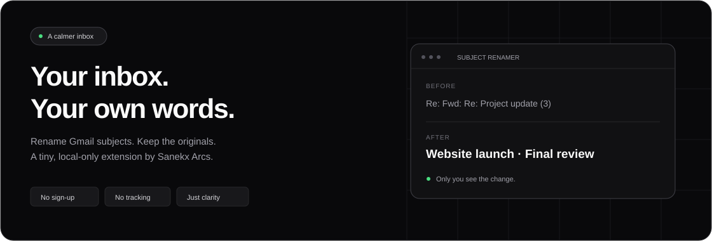

<p align="center">
  
</p>

<h1 align="center">Gmail Subject Renamer</h1>

<p align="center">
  <strong>Your inbox. Your own words.</strong><br />
  Give confusing email subjects a name that makes sense — without changing the actual email.
</p>

<p align="center">
  <a href="#installation">Install locally</a> ·
  <a href="#how-to-use">How to use</a> ·
  <a href="https://github.com/SanekxArcs/rename-subject-gmail/issues">Report an issue</a> ·
  <a href="https://github.com/SanekxArcs">Meet the creator</a>
</p>



## Small extension. Less inbox noise.

Turn **“Re: Fwd: Re: Project update (3)”** into **“Website launch · Final review”**.
Choose a color, add emphasis, and find your bearings the next time you open your inbox.

- **Rename in place.** Edit subjects from your inbox or an open conversation.
- **Make important threads stand out.** Add a custom color, bold, or italic text.
- **Add service labels.** Optional tags for Autocomplete, Search, Recommendations, PLP, PDP, and Shopping Assistant.
- **Pause with one switch.** Restore the original display without deleting your saved names. Turn it back on to reapply them.
- **Keep it local.** No extension account, Gmail API authorization, analytics, or remote backend.
- **Enjoy a quieter interface.** A shadcn/ui-inspired popup and editor, light/dark system themes, and keyboard focus styles.

## Installation

This repository is loaded as an **unpacked Chrome extension**. No build step or package installation is required.

1. [Download the source ZIP](https://github.com/SanekxArcs/rename-subject-gmail/archive/refs/heads/main.zip) and extract it, or clone the repository:

   ```sh
   git clone https://github.com/SanekxArcs/rename-subject-gmail.git
   ```

2. Open `chrome://extensions` in Chrome.
3. Enable **Developer mode** in the top-right corner.
4. Click **Load unpacked** and select the folder containing `manifest.json`.
5. Open or refresh [Gmail](https://mail.google.com/).
6. Pin **Gmail Subject Renamer** from Chrome's extensions menu for quick access to the on/off switch.

**Updating an existing installation?** Click **Reload** on the extension card, then refresh any open Gmail tabs.

## How to use

1. Hover over a subject in your inbox and click the **pencil** icon, or open a conversation and click the pencil beside its heading.
2. Enter your new subject. Optionally choose a color, text style, or service labels.
3. Click **Save**, or press **Enter** while the subject field is focused.

Click an already-renamed inbox subject to edit it again. Choose **Reset to original** to remove its saved customization. Press **Escape** to dismiss the editor without saving.

### The toolbar popup

Click the extension icon to:

- Turn the extension **on or off** across open Gmail tabs, without a page reload.
- See the number of locally saved subjects.
- Open Gmail, visit the project, leave a star, or follow the creator.

The switch defaults to **on**. When paused, original subject text and styles return, editing controls disappear, and saved customizations stay on your device.

## Privacy & permissions

| Permission | Why it is needed |
| --- | --- |
| `storage` | Store custom subjects, recent colors, and the on/off preference in `chrome.storage.local`. |
| `https://mail.google.com/*` | Run the content script that displays and edits subjects inside Gmail. |

The extension changes **only the rendered page**. It does not modify Gmail messages, send emails, or change what recipients see. It makes no background network requests; the popup's external links open only when you click them.

Saved names are not synchronized to other devices and are not part of Gmail's server-side search index. Removing the extension or clearing its local storage removes its saved customizations. Renames are keyed by Gmail thread ID within the browser profile, not partitioned by Google account; avoid using it for sensitive cross-account labeling.

## Under the hood

A Manifest V3 content script observes Gmail's page updates and applies saved customizations to matching thread subjects. A storage-change listener keeps the toolbar switch and open Gmail tabs in sync.

The interface uses lightweight HTML, CSS, and JavaScript with **shadcn/ui-inspired styling**, rather than React or the shadcn component package. There are no runtime dependencies, hosted fonts, or remote scripts.

```text
rename-subject-gmail/
├── manifest.json              Extension configuration (Manifest V3)
├── popup.html / .css / .js    Toolbar popup, status, and enable switch
├── content.js                 Gmail integration, storage, and subject editor
├── content.css                Scoped Gmail editor styles
├── icons/                     SVG source and 16/32/48/128 px PNG icons
├── docs/banner.svg            README artwork
└── scripts/generate-icons.ps1 Windows PNG icon generator
```

### Development checks

```sh
node --check content.js
node --check popup.js
git diff --check
```

To regenerate the packaged icons on Windows:

```powershell
powershell -ExecutionPolicy Bypass -File scripts/generate-icons.ps1
```

After editing, reload the extension and refresh Gmail. Check inbox and conversation views, save/reset, pause/resume with more than one Gmail tab, keyboard navigation, and light/dark appearance. Gmail's DOM can change, so syntax checks alone cannot verify live compatibility.

## Support the project

Built by **[Sanekx Arcs](https://github.com/SanekxArcs)**.

If this makes your inbox a little calmer, **[leave a star on GitHub](https://github.com/SanekxArcs/rename-subject-gmail)** and **[follow @SanekxArcs](https://github.com/SanekxArcs)** for more projects.

Found a bug or have an idea? [Open an issue](https://github.com/SanekxArcs/rename-subject-gmail/issues) with a short description and reproduction steps. Please remove private email content from screenshots.

---

An independent project, not affiliated with or endorsed by Google. Gmail is a trademark of Google LLC.
